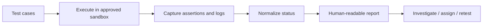

# Automated Test Reporting and Failure Triage

A test log is useful only when a reviewer can answer: **which behavior failed, in which environment, against which fixture, and can the failure be reproduced?** This guide uses invented identifiers and statuses.

## Evidence pipeline



## Minimal synthetic results

| Test ID | Fixture | Expected | Illustrative status |
|---|---|---|---|
| S-001 | Four fake rows | Total count 4 | PASS (example, not executed) |
| S-002 | Duplicate key | Validation error | PASS (example, not executed) |
| S-003 | Missing reporting month | Explicit no-data state | NOT RUN |

A robust automation report distinguishes `PASS`, `FAIL`, `BLOCKED`, `SKIPPED` and `NOT RUN`. Do not count `SKIPPED` as passing. A flaky test should have an owner and a repair plan, rather than being silently removed.

## Example evidence payload

```json
{
  "test_id": "SYNTH-001",
  "environment": "local-demo",
  "fixture": "fictional-cases-v1",
  "expected": "4 eligible records",
  "observed": null,
  "status": "NOT_RUN",
  "evidence": []
}
```

## Report quality checks

- Show execution timestamp, code version and test fixture version.
- Keep assertion message separate from infrastructure errors.
- Capture attachments only if non-sensitive; redact secrets and personal details.
- Link the exact failing scenario to a reproducible test.
- Never report an unexecuted plan as passing or use a successful email notification as proof of successful tests.

### Reporting channel

A report may be written to local JSON/HTML and, **only with explicit permissions**, delivered by email or a secure messaging system. Do not put SMTP credentials in tracked YAML, source or logs.

**RU:** полезная отчётность QA — не количество зелёных тестов, а воспроизводимые ошибки, их контекст, evidence и статус повторной проверки.

References: [pytest reports](https://docs.pytest.org/en/stable/how-to/output.html), [JUnit XML](https://docs.pytest.org/en/stable/how-to/output.html#creating-junitxml-format-files).
